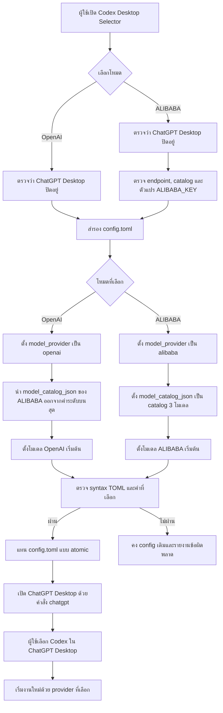

# Codex Desktop provider selector

เอกสารนี้อธิบายวิธีทำตัวเลือกสำหรับสลับ Codex ใน ChatGPT Desktop ระหว่าง OpenAI และ LiteLLM ThinkStation โดยผู้ใช้ไม่ต้องแก้ `~/.codex/config.toml` เองทุกครั้ง

> สถานะ: ติดตั้ง selector แล้ว ใช้ได้กับ Codex CLI/TUI และ Codex ใน ChatGPT Desktop

## เป้าหมาย

ตัว selector มีสองโหมด:

- **OpenAI** ใช้รายการโมเดลทั้งหมดที่บัญชี OpenAI แสดงใน Codex Desktop รายการนี้เปลี่ยนตามสิทธิ์ของบัญชีและ catalog ปัจจุบันของ OpenAI
- **ALIBABA** ใช้ LiteLLM ที่ ThinkStation ผ่าน `http://10.28.15.77:4000/v1` และแสดงเฉพาะ `deepseek-v4.1-flash`, `qwen3.8-max`, และ `qwen3.8-flash`

ตัว selector เป็นโปรแกรมก่อนเปิด ChatGPT Desktop ไม่ใช่เมนูที่ฝังใน model picker ของ Codex Desktop

## เหตุผลที่ต้องสลับทั้งโหมด

Codex Desktop ยังไม่มี model picker ที่สลับหลาย provider ได้อย่างสมบูรณ์ `model_catalog_json` ใช้ catalog ที่ระบุแทน catalog เดิม ไม่ได้นำ custom models ไปรวมกับรายการ OpenAI

ผลที่ได้จึงเป็น:

```text
โหมด OpenAI
└── โมเดล OpenAI ทั้งหมดที่บัญชีใช้งานได้

โหมด ALIBABA
├── deepseek-v4.1-flash
├── qwen3.8-max
└── qwen3.8-flash
```

การเลือก ALIBABA ไม่ได้ลบโมเดล OpenAI เมื่อสลับกลับ OpenAI และเปิด Desktop ใหม่ รายการ OpenAI จะกลับมาตามสิทธิ์ของบัญชี

## Workflow



## สิ่งที่ selector ต้องทำ

1. ใช้ lock เพื่อป้องกันการสลับสองครั้งพร้อมกัน
2. ตรวจว่า ChatGPT Desktop ปิดอยู่ก่อนแก้ config
3. สำรอง `~/.codex/config.toml` พร้อม timestamp
4. เปลี่ยนเฉพาะค่าระดับบนสุดต่อไปนี้:
   - `model`
   - `model_provider`
   - `model_catalog_json`
5. คงค่า MCP, sandbox, project, provider definitions และค่าอื่นทั้งหมด
6. ตรวจ TOML ก่อนแทนไฟล์จริง
7. เขียนไฟล์ชั่วคราวใน filesystem เดียวกัน แล้วแทน `config.toml` แบบ atomic
8. ถ้าการตรวจล้มเหลว ให้คง config เดิม
9. เปิด ChatGPT Desktop ด้วย `chatgpt`
10. แสดงโหมดที่กำลังใช้งาน

## ค่าแต่ละโหมด

### OpenAI

ตัว selector ต้องทำให้ค่าระดับบนสุดมีรูปแบบนี้:

```toml
model = "gpt-5.6-terra"
model_provider = "openai"
```

ตัว selectorต้องไม่กำหนด `model_catalog_json` ของ ALIBABA ในโหมดนี้ เพื่อให้ Desktop โหลด catalog ปัจจุบันของ OpenAI

### ALIBABA

ตัว selectorต้องทำให้ค่าระดับบนสุดมีรูปแบบนี้:

```toml
model = "qwen3.8-flash"
model_provider = "alibaba"
model_catalog_json = "/home/pongsak/.codex/model-catalog-alibaba.json"
model_reasoning_effort = "medium"
```

Provider definition ที่มีอยู่แล้วใน `~/.codex/config.toml` ต้องคงรูปแบบนี้:

```toml
[model_providers.alibaba]
name = "ALIBABA via LiteLLM ThinkStation"
base_url = "http://10.28.15.77:4000/v1"
env_key = "ALIBABA_KEY"
wire_api = "responses"
requires_openai_auth = false
```

ค่าจริงของ virtual key อยู่ใน `~/.codex/.env` และต้องไม่ฝังใน selector หรือเอกสาร

## ไฟล์ที่เกี่ยวข้อง

```text
~/.codex/config.toml
~/.codex/.env
~/.codex/ALIBABA.config.toml
~/.codex/model-catalog-alibaba.json
~/projects/codex-custom-api-settings/backups/
```

`ALIBABA.config.toml` ใช้กับ Codex CLI ผ่าน `--profile ALIBABA` ส่วน Codex Desktop อ่านค่าหลักจาก `~/.codex/config.toml`

## Installation

- **Windows (ไม่ต้องติดตั้ง Codex CLI)**: See [QUICKSTART-WINDOWS.md](QUICKSTART-WINDOWS.md) — สำหรับเครื่องที่บริษัท block npm หรือต้องการใช้เฉพาะ ChatGPT Desktop
- **Windows (เต็มรูปแบบ)**: See [INSTALL-WINDOWS.md](INSTALL-WINDOWS.md)
- **Linux**: See [INSTALL-LINUX.md](INSTALL-LINUX.md)

## วิธีใช้ selector ที่ติดตั้งแล้ว

ตรวจโหมดปัจจุบัน:

```bash
codex-selector status
```

สลับ Codex CLI/TUI เป็น OpenAI โดยไม่ restart Desktop:

```bash
codex-selector openai
codex
```

สลับ Codex CLI/TUI เป็น ALIBABA โดยไม่ restart Desktop:

```bash
codex-selector alibaba
codex
```

สลับทั้ง Codex CLI/TUI และ ChatGPT Desktop:

```bash
codex-selector openai --restart-desktop
codex-selector alibaba --restart-desktop
```

Application Menu มี launcher สองรายการ:

```text
Codex — OpenAI
Codex — ALIBABA
```

launcher ทั้งสองรายการสลับ config และ restart ChatGPT Desktop ให้อัตโนมัติ ตัว selector เก็บ backup ก่อนเปลี่ยนทุกครั้งที่:

```text
~/projects/codex-custom-api-settings/backups/selector/
```

## การเปิด Desktop จาก Terminal

ใช้คำสั่ง:

```bash
chatgpt
```

หากต้องการคืน prompt ทันที:

```bash
chatgpt >/dev/null 2>&1 &
```

คำสั่ง `codex` เปิด Codex CLI/TUI ไม่ใช่ ChatGPT Desktop

## วิธีใช้หลังสร้าง selector

ผู้ใช้เลือกเพียงหนึ่งโหมด:

```text
Codex — OpenAI
Codex — ALIBABA
```

จากนั้น selector จะสำรอง config, เปลี่ยนโหมด, ตรวจไฟล์ และเปิด ChatGPT Desktop ใหม่ ผู้ใช้ไม่ต้องเปิดหรือแก้ TOML ด้วยตนเอง

## ข้อจำกัด

- ต้องปิดและเปิด ChatGPT Desktop ใหม่เมื่อเปลี่ยนโหมด เพราะ Desktop โหลด provider และ catalog ตอนเริ่มโปรแกรม
- ไม่ควรเปิดโหมด OpenAI และ ALIBABA พร้อมกันผ่าน `CODEX_HOME` เดียวกัน
- ในโหมด ALIBABA model picker จะแสดงเฉพาะสามโมเดลที่กำหนด
- ในโหมด OpenAI model picker จะแสดงโมเดลทั้งหมดที่บัญชีได้รับ ไม่จำกัดแค่ Sol, Terra, และ Luna สามรุ่น
- ยังไม่ควรรวม catalog OpenAI และ ALIBABA ด้วยมือ เพราะ catalog OpenAI อาจเปลี่ยน และ Desktop ยังไม่รองรับการเลือก provider ต่อโมเดลอย่างเป็นทางการ
- ChatGPT chats ปกติไม่ผ่าน LiteLLM การตั้งค่านี้มีผลกับ Codex ใน ChatGPT Desktop

## ผลการตรวจใช้งาน

ตรวจบน Latitude แล้ว:

- OpenAI: `codex exec` ใช้ `gpt-5.6-terra` ผ่านและตอบ `SELECTOR_OPENAI_OK`
- OpenAI Desktop catalog: Codex runtime อ่านได้ 11 รายการในเวลาที่ทดสอบ
- ALIBABA config: Codex Doctor โหลด `qwen3.8-flash · alibaba` และพบ `ALIBABA_KEY` โดยไม่แสดงค่า key
- ALIBABA Desktop catalog: Codex runtime อ่าน `deepseek-v4.1-flash`, `qwen3.8-max`, และ `qwen3.8-flash` ครบสามรายการ
- ChatGPT Desktop: selector ปิดและเปิด process ใหม่ได้ทั้งสองโหมด
- ALIBABA inference รอบล่าสุดยังไม่ผ่าน เพราะ ThinkStation ติดต่อ Alibaba Token Plan ไม่สำเร็จ โดย LiteLLM บันทึก `SSL handshake ... aborting` ไปยัง upstream ข้อผิดพลาดนี้อยู่หลัง selector และ Codex config

## การทดสอบที่ต้องผ่านก่อนใช้งานจริง

1. ตรวจว่าเลือก OpenAI แล้วรายการโมเดล OpenAI กลับมาครบตามบัญชี
2. ตรวจว่าเลือก ALIBABA แล้วเห็นสามโมเดลที่กำหนด
3. เริ่มงานใหม่และยืนยันจาก LiteLLM logs ว่าคำขอใช้ virtual key ที่ถูกต้อง โดยไม่แสดงค่า key
4. ทดสอบ response streaming และ shell tool call อย่างน้อยหนึ่งครั้งในแต่ละโมเดล ALIBABA
5. ทำให้ TOML ไม่ผ่านการตรวจ แล้วตรวจว่า selector ไม่แทน config เดิม
6. หยุด selector ระหว่างเปลี่ยนไฟล์ แล้วตรวจว่า `config.toml` ยังสมบูรณ์
7. สลับกลับ OpenAI แล้วตรวจว่า chat และ project เดิมยังแสดง

## เอกสารอ้างอิง

- [LiteLLM: Connect Codex in ChatGPT Desktop to LiteLLM](https://docs.litellm.ai/docs/proxy/client_setup/codex_chatgpt_desktop)
- [OpenAI: Roll out a gateway](https://developers.openai.com/codex/enterprise/roll-out-a-gateway)
- [OpenAI Codex issue #22160: Desktop picker does not expose custom profiles](https://github.com/openai/codex/issues/22160)
- [OpenAI Codex issue #29156: Desktop custom providers and model picker limitations](https://github.com/openai/codex/issues/29156)

## Backup

ย้าย backup เดิมมาไว้ที่:

```text
/home/pongsak/projects/codex-custom-api-settings/backups/
```

ภายในมี backup สองชุด:

```text
backups/
├── codex-20261029-115629/
└── codex-20261029-115649/
```

ตรวจ SHA-256 ของ `codex-config.tar` ทั้งสองชุดแล้วตรงกับค่าเดิมใน `SHA256SUMS` ไฟล์ `SHA256SUMS` ยังบันทึก absolute path เก่า จึงต้องตรวจด้วยชื่อ archive และ digest แทนการใช้ `sha256sum -c` โดยตรงหลังย้ายตำแหน่ง
